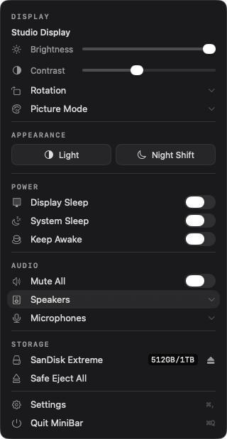
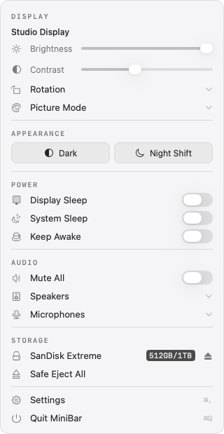
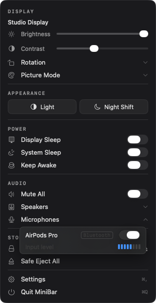

# MiniBar

**[中文](README.zh-CN.md)**

Brightness, volume, power and storage — one native panel in your menu bar.

Built with SwiftUI and AppKit. No Electron, no background bloat.

> v0.3.0 · macOS 15+ · Apple Silicon only

---

## Overview

Dark and light. Follows your system until you choose otherwise.

  
  

---

## Features

### Display Control
Brightness and contrast on native sliders, with fine scroll-wheel adjustment and rotation.

> ⚠ Picture Mode is visible in the panel but not yet implemented.

### Power
Display sleep, system sleep and keep-awake — one toggle each, no digging through System Settings.

### Audio Routing
Mute everything, or route speakers and microphones to AirPods and other devices, with a live input level meter.

### Storage
Used and total space at a glance. Eject one drive, or safely eject all.

### Modular by Design
Enable what you need. Off means gone from the panel, using no memory.

### Eleven App Languages
The app ships in 11 languages. Long labels measure their own width so they never collide with sliders — tested up to Japanese width.

---

## Made for AirPods

Pick your output and input in two clicks. The live meter shows your microphone is actually working — no guessing, no test calls.

Devices are enumerated when you open the panel, and the meter only runs while its row is expanded. Close it, and everything stops.

  

---

## About

MiniBar is a personal open-source project by @Samuelonly. It lives in your menu bar and stays out of your way: no Dock icon, no polling while the panel is closed, and modules that fully unload when disabled.

**Tags:** Volume Control · Brightness Control · Contrast Control · Mac mini Control · Night Shift · Audio Routing · AirPods · Input Level Meter · Display Sleep · Keep Awake · Safe Eject · Menu Bar App · SwiftUI · AppKit · No Electron · Open Source

---

## License

[GPL-3.0](LICENSE) © Samuelonly
