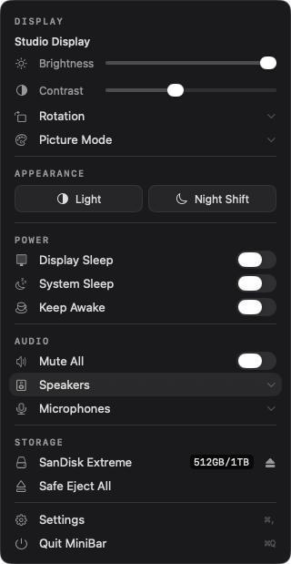
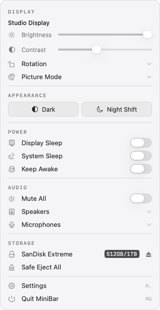
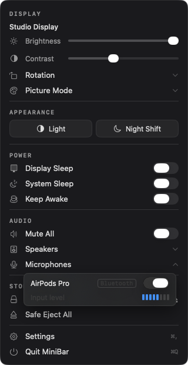

# MiniBar

**[English](README.md)**

亮度、音量、电源、存储——菜单栏里的一个原生面板。

由 SwiftUI 与 AppKit 打造。没有 Electron，没有臃肿的后台。

> v0.3.0 · macOS 15+ · 仅支持 Apple Silicon

---

## 概览

深色与浅色。默认跟随系统，你点过一次就听你的。

  
  

---

## 功能

### 显示控制
原生滑杆调节亮度与对比度，滚轮微调，支持旋转方向。

> ⚠ 画质模式已显示在面板中，但尚未实现。

### 电源管理
屏幕休眠、系统休眠、防休眠，各一个开关，不用再翻系统设置。

### 音频路由
一键全局静音，扬声器与麦克风可切换到 AirPods 等设备，输入电平实时可见。

### 存储管理
已用与总容量一目了然。可弹出单个盘，也可安全弹出全部。

### 模块化设计
用哪个，开哪个。关闭立刻从面板里消失，不占内存。

### App 内 11 种语言
应用内置 11 种语言界面。标签按文字实际宽度自适应——实测覆盖日语长度——再长的翻译也不会和滑杆挤在一起。

---

## 为 AirPods 而生

两下点击切换输出与输入设备。实时电平表告诉你麦克风真的在工作——不用猜，也不用打测试电话。

设备在你打开面板时才枚举，电平表只在子行展开时运行。一收起，全部停止。

  

---

## 关于

MiniBar 是 @Samuelonly 的个人开源项目。它住在菜单栏，不打扰你：没有 Dock 图标，面板关闭时不轮询，模块关闭后彻底卸载。

**标签：** 音量控制 · 亮度控制 · 对比度控制 · Mac mini 控制 · 夜览 · 音频路由 · AirPods · 输入电平表 · 屏幕休眠 · 防休眠 · 安全弹出 · 菜单栏应用 · SwiftUI · AppKit · 无 Electron · 开源

---

## 协议

[GPL-3.0](LICENSE) © Samuelonly
